# The claude-mesh codebase, end to end

This is a guided tour of every part of claude-mesh, in the order a file travels: from one Mac's disk, through the network, onto another Mac's disk. Each section says what the code does, why it's shaped that way, and what's still fragile.

The reference is the rustdoc, which covers every item, private ones included:

```sh
cargo doc --document-private-items --open
```

| Section | Module | Lines |
|---|---|---|
| [0. The whole picture](#0-the-whole-picture) | | |
| [1. Where things live](#1-where-things-live-layout) | `src/layout.rs` | ~110 |
| [2. The canonical form](#2-the-canonical-form-canon) | `src/canon.rs` | ~230 |
| [3. What is synced](#3-what-is-synced-scan) | `src/scan.rs` | ~240 |
| [4. Reaching a peer](#4-reaching-a-peer-airshell-and-wire) | `src/airshell.rs`, `src/wire.rs` | ~490 |
| [5. A round, file by file](#5-a-round-file-by-file-sync) | `src/sync.rs` | ~500 |
| [6. Two versions, one result](#6-two-versions-one-result-merge) | `src/merge.rs` | ~190 |
| [7. Commands and the loop](#7-commands-and-the-loop-main) | `src/main.rs` | ~310 |
| [8. Tests](#8-tests) | `tests/mesh.rs` | ~420 |
| [9. Around the code](#9-around-the-code-build-cache-deploy-health) | flake, CI, claude-code-nix, nix-darwin | |
| [10. What's fragile](#10-whats-fragile) | | |

Three dependencies (`serde`, `serde_json`, `blake3`), `std` threads, no async runtime.

---

## 0. The whole picture

Claude Code keeps everything about a conversation in its config folder: transcripts, memory, plans, todos, prompt history. Each Mac has its own. claude-mesh makes the three folders converge, so `claude --resume` on any Mac lists every session from every Mac.

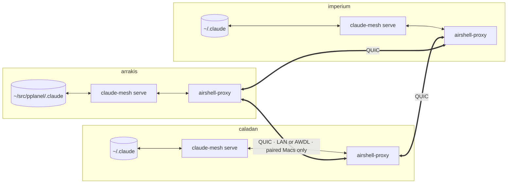

Four ideas hold the design together:

1. **Pull-only.** Every 30 s each Mac asks each peer "what do you have?" and pulls what's new into *its own* folder. No Mac ever writes to another. A bug, or a bad peer, can make a Mac fetch too much, but it can never corrupt someone else's files.
2. **Canonical form.** The Macs keep things in different places (`~/src/pplanel/.claude` on arrakis, `~/.claude` elsewhere), and Claude bakes those paths into folder names and transcripts. Everything travels with the Mac-specific paths swapped for tokens (`@SRC@`, `@CFG@`), so the same conversation has the same hash everywhere.
3. **Symmetric merges.** When two Macs have different versions, each merges them independently. Because `merge(a, b) == merge(b, a)`, both reach the same bytes without talking about it.
4. **airshell does the networking.** Identity (a Secure Enclave key per Mac), pairing, encryption and the radio (LAN or AWDL) are airshell's. claude-mesh holds no keys and opens no network sockets: it listens on localhost and dials through `airshell-connect`.

---

## 1. Where things live (`layout`)

[`src/layout.rs`](../src/layout.rs) answers one question: on Mac *X*, where are the sources and where is the personal Claude config?

| Mac | Sources | Claude config |
|---|---|---|
| arrakis | `/Users/pplanel/src/pplanel` | `/Users/pplanel/src/pplanel/.claude` |
| caladan, imperium | `/Users/pplanel/src` | `/Users/pplanel/.claude` |

arrakis is the odd one: it's the employer's machine, so the personal account lives under its source folder (`claude-personal` sets `CLAUDE_CONFIG_DIR`). That one fact causes most of the interesting problems below, because **arrakis's config folder is inside its source folder**.

The table is read, in order, from:

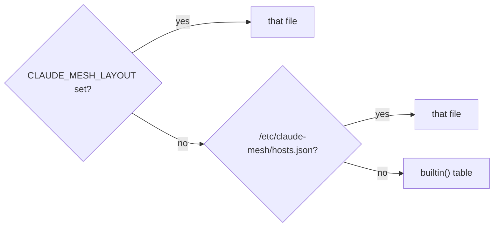

In production, claude-code-nix sets `CLAUDE_MESH_LAYOUT` to a JSON it generates from `handoff.hosts`, **the same table `claude-handoff` uses**, so the mesh and the handoff can't disagree about where things live. The built-in copy is for running outside nix.

`project_key()` mirrors how Claude names project folders: the path with `/` and `.` turned into `-`, so `/Users/pplanel/src/pplanel/shift-compute` becomes `-Users-pplanel-src-pplanel-shift-compute`.

---

## 2. The canonical form (`canon`)

[`src/canon.rs`](../src/canon.rs) is the translation layer. A `Canon` is built from one Mac's `Host` and rewrites two things.

**Names.** Only the project folder under `projects/` depends on the Mac:

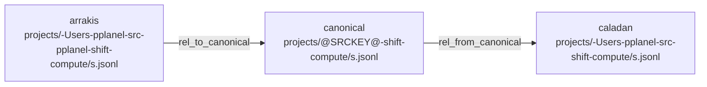

The key only matches at a `-` boundary, so `-Users-pplanel-srcfoo` isn't mistaken for the source folder. The config folder's key is checked first (`@CFGKEY@`) because on arrakis it *starts with* the source key.

**Contents.** For text files (`.jsonl`, `.json`, `.md`, `.txt`), plain string replacement, longest path first:

```
on arrakis:   {"cwd":"/Users/pplanel/src/pplanel/shift-compute", "m":"/Users/pplanel/src/pplanel/.claude/…"}
canonical:    {"cwd":"@SRC@/shift-compute",                      "m":"@CFG@/…"}
on caladan:   {"cwd":"/Users/pplanel/src/shift-compute",         "m":"/Users/pplanel/.claude/…"}
```

The order matters: on arrakis `/Users/pplanel/src/pplanel/.claude` contains `/Users/pplanel/src/pplanel`, so the config path is replaced before the source path. Everything else (images, binary tool results) is copied byte for byte.

### When it isn't reversible

This is the part to really understand, because it's behind two of the bugs fixed on 2026-10-11. **Text replacement is not a bijection.** Two different canonical texts can become the same local text, and a local text can read back as a different canonical text than it was written from:

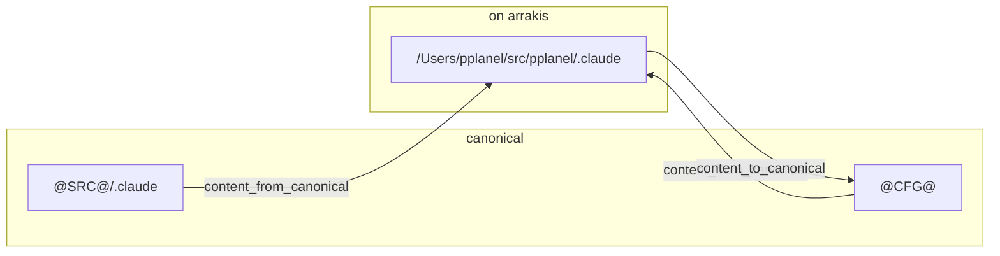

On caladan, `@SRC@/.claude` is a real, different path (`/Users/pplanel/src/.claude`). On arrakis it lands on the config folder's path, which reads back as `@CFG@`. Likewise, a transcript that *quotes* `/Users/pplanel/src/.claude` keeps it as plain text on arrakis but turns it into `@SRC@/.claude` on caladan.

The consequence: **a file written from canonical bytes `c` may read back as `c' ≠ c`.** The sync code never assumes the round trip holds:
- it remembers the hash of what it *reads back*, not of what it wrote (section 5, step 7);
- it compares files *on disk*, not just canonical hashes (step 5);
- it keeps the peer's own copy as the base for tails (section 5, "Tails").

The quoted path itself can still end up rewritten in the file. That's the documented limit of textual rewriting (`docs/operations.md`).

---

## 3. What is synced (`scan`)

[`src/scan.rs`](../src/scan.rs) decides what leaves a Mac and describes it.

**Only these top-level entries** (`INCLUDE`) are walked:

| Synced | Why |
|---|---|
| `projects/` | transcripts, subagent transcripts, tool results, per-project `memory/` |
| `plans/`, `todos/`, `tasks/` | plan-mode files and task lists |
| `file-history/` | snapshots used by rewind |
| `agents/`, `commands/` | user-defined subagents and slash commands |
| `history.jsonl` | prompt history (up-arrow) |

Everything else stays put: credentials, `settings.json` (nix-managed), plugins, caches, `sessions/` (per-process), the quota hook's marks. Symlinks are never followed (nix-managed skills are symlinks into the store), and files over 64 MiB are skipped.

**The manifest** is `canonical path → Entry { hash, size, mtime }`, where `hash` is BLAKE3 of the *canonical* contents. Hashing everything every 30 s would be wasteful, so the `Scanner` remembers each file's entry and re-reads a file only when its size or mtime changed:

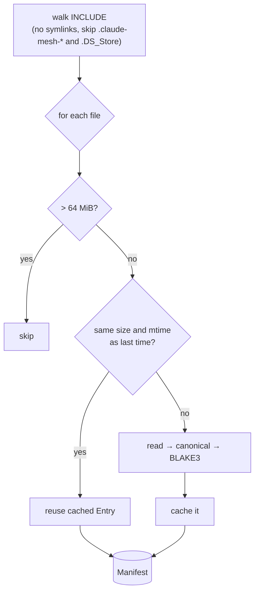

`local_path()` is the safety gate for anything a peer names: the path must be relative, have no `..`, `.` or empty parts, and start with an `INCLUDE` entry. A peer asking for `../../.ssh/id_ed25519` or `.credentials.json` gets nothing.

---

## 4. Reaching a peer (`airshell` and `wire`)

### Registering with the proxy

When `serve` starts, it makes sure this Mac's airshell-proxy advertises it ([`src/airshell.rs`](../src/airshell.rs)). It talks to the proxy's **control socket**, a Unix socket in the per-user temp dir, speaking airshell's newline-delimited JSON protocol:

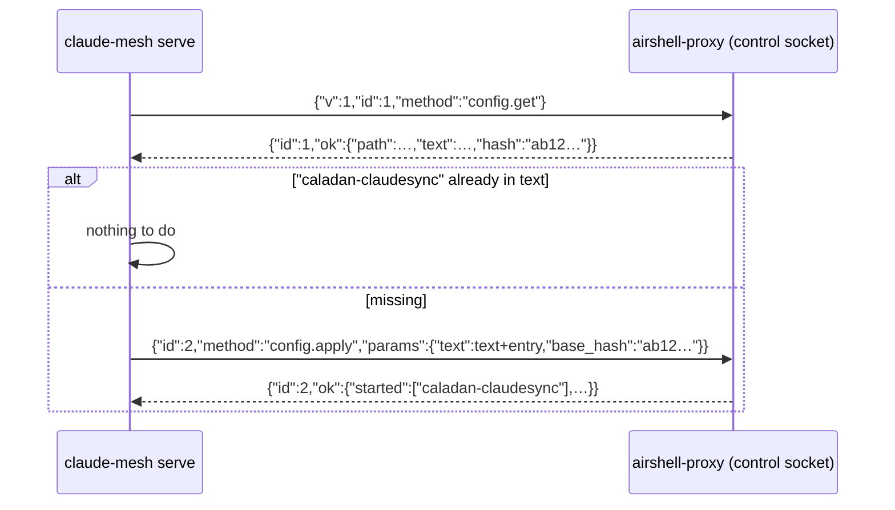

The entry it appends is a QUIC service relayed to the local server:

```toml
[[service]]
name = "caladan-claudesync"
transport = "quic"
service_type = "_claudesync._udp"
host = "127.0.0.1"
port = 7480
```

`base_hash` makes it safe: if someone edited the file in between, the proxy refuses (`conflict`) instead of overwriting. claude-mesh uses plain `serde_json` here rather than airshell's own `airshell-proto` crate, so it doesn't depend on airshell's private repo.

### The protocol

[`src/wire.rs`](../src/wire.rs) is the line protocol a round speaks over one stream. Requests are one line each; every response is a header `ok <len>` or `err <len>`, then exactly `<len>` bytes:

| Request | Response body |
|---|---|
| `health` | `{"host":"caladan","version":"0.1.0"}` |
| `manifest` | the `Manifest` as JSON |
| `file <hex path>` | the canonical bytes of that file |
| `tail <hex path> <offset>` | those bytes from `offset` on |

Paths are hex-encoded so a name with spaces or newlines can't break the framing. An `err` still sends a complete response, so the stream stays in step and the client can fall back on the same connection (`tail` → `file`).

### A round over the wire

On the dialing side, a `Peer` is either a `tcp:<addr>` connection (tests) or **a command whose stdin/stdout is the stream**. In production that command is `airshell-connect caladan-claudesync --transport quic --service-type _claudesync._udp`: airshell's client is just a byte pipe, so claude-mesh never touches the network itself.

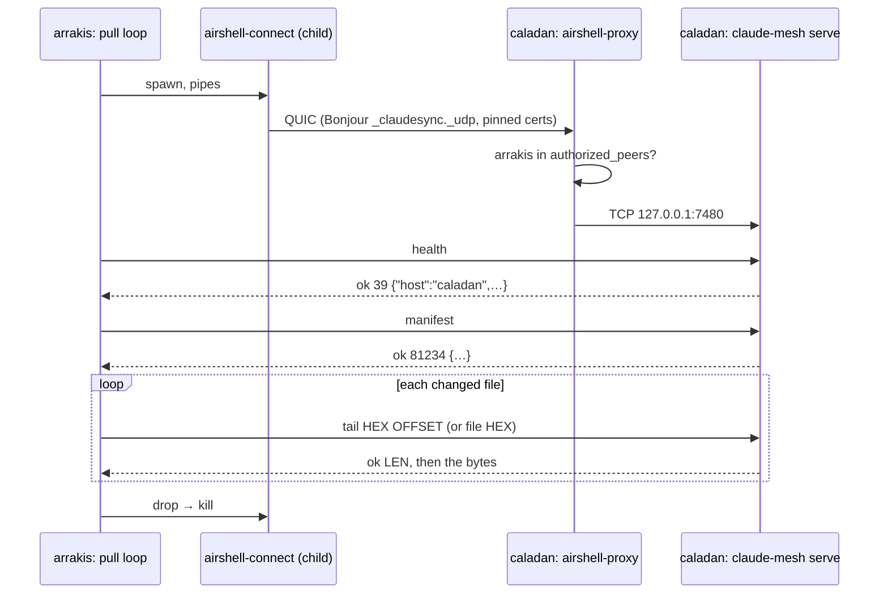

`Peer::connect` sends `health` first and gives the route 20 s (`CONNECT_TIMEOUT`) to answer, with a watchdog that kills a hanging `airshell-connect` (peer not found, AWDL down). On failure, the last line of airshell-connect's stderr becomes the error, which is how messages like "this Mac isn't in its authorized_peers" reach the log.

On the serving side, `serve_tcp` gives each connection its own thread, which answers requests until the client hangs up.

---

## 5. A round, file by file (`sync`)

[`src/sync.rs`](../src/sync.rs) is the heart. `sync_peer` takes the peer's manifest and, for every file in it, walks this decision:

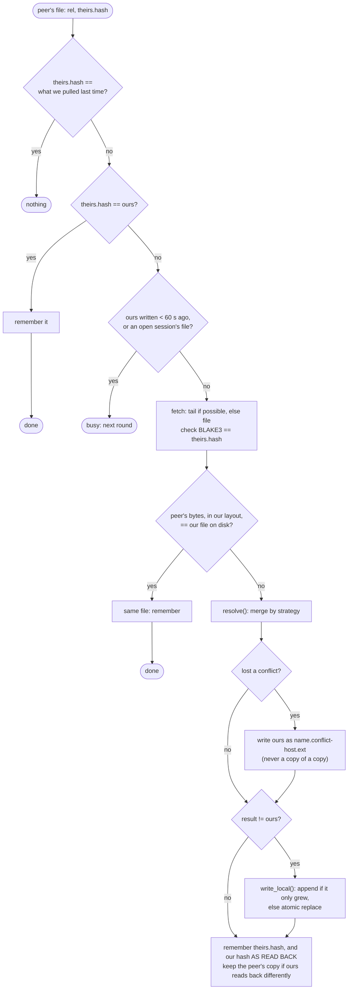

### What carries over: `State`

`~/.local/state/claude-mesh/state.json`, outside the synced folder:

- `seen[peer][path]`: the peer's hash when we last pulled it. This is step 1: a file the peer hasn't changed is skipped without any I/O.
- `local[path]`: our copy's hash right after we last synced it. If our copy still has that hash, *we* haven't touched it since, so a peer's newer version simply replaces it. If ours changed too, it's a real conflict.

### Leaving live files alone

A Claude session appends to its transcript as it goes. claude-mesh must never rewrite a file under it. There are two guards:

1. **Recently written** (`ACTIVE_WINDOW_MS`, 60 s): checked before fetching, and again just before writing.
2. **An open session** (`live_sessions`): Claude Code keeps `sessions/<pid>.json` with each running process's `sessionId`. While that pid is alive, the session's transcript and its folder (subagents, tool results) are never touched, however long they've been quiet.

The second guard exists because the first isn't enough: on 2026-10-11 a 150 s tool call left a session quiet past 60 s, and arrakis merged an old branch into its live transcript.

### Writing

`write_local` turns the merged canonical result back into local form and:
- **appends** when the result just extends what's on disk (a log that grew), so a session that resumes writing mid-sync never sees its file swapped;
- otherwise **replaces atomically**: a temp file `.claude-mesh-<pid>-<hash>.tmp` next to it, then a rename. Readers see the old file or the new one, never half. The temp name is short whatever the target's name, because a 250-byte name plus a prefix would pass the 255-byte limit.

A file that can't be written (a project name too long for arrakis's longer paths, a permission) is logged as `failed` and skipped. The rest of the round goes on.

### Tails: fetching only what's new

Transcripts only grow at the end, but a busy session is megabytes. Re-fetching it whole every round cost 791 MiB an hour before tails existed. `fetch_tail` asks only for the bytes past what we have:

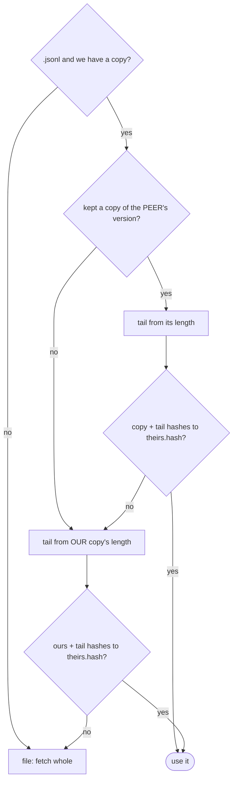

The hash check makes it safe: a tail is only used if base + tail is exactly the peer's file. A peer that's too old for `tail` answers `err`, which falls back the same way.

Why keep **the peer's copy** (`state.peers/<peer>/`)? Our own copy is only a valid base if it's a prefix of the peer's, and two common cases break that:
- **diverged sessions**: a session continued on two Macs. Our merged copy has both branches, theirs has one, and it stays that way while the session is open on their side;
- **non-reversible paths** (section 2): our copy reads back as different canonical bytes than the peer's, even with nothing diverged.

So whenever our copy, read back, isn't the peer's, we keep the peer's version and take its next tail from there. Once the two agree again, the copy is dropped.

---

## 6. Two versions, one result (`merge`)

[`src/merge.rs`](../src/merge.rs) has three rules, chosen by file name (`strategy_for`):

| Files | Rule |
|---|---|
| `*.jsonl` | `merge_jsonl` |
| `memory/MEMORY.md` | `merge_line_union` |
| everything else | `last_writer_wins`, the loser kept as a conflict copy |

### Logs: `merge_jsonl`

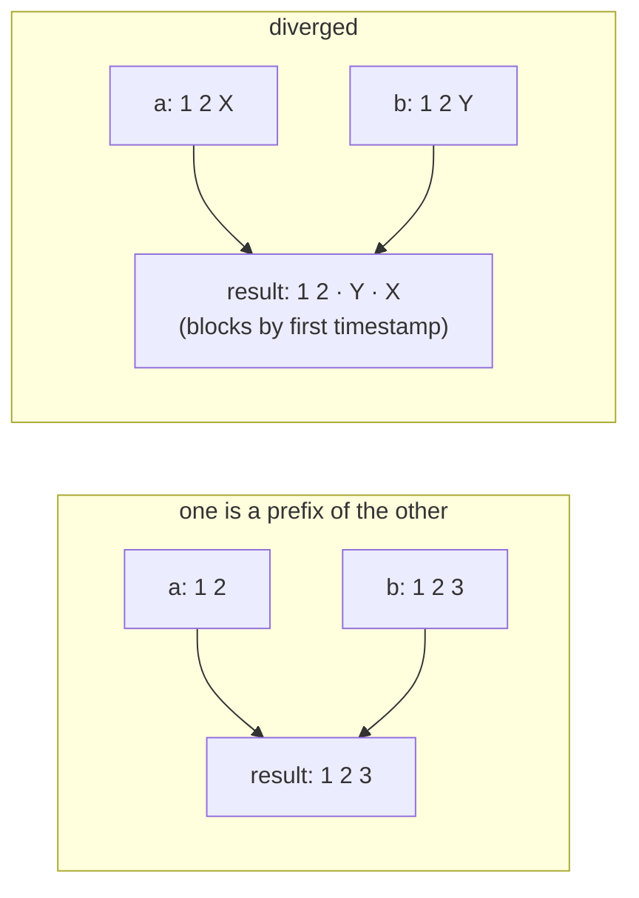

The usual case is a prefix: a session moved Macs and kept going, so the longer version wins. When the two diverged, the result is the shared prefix, then each side's new lines as a block, blocks ordered by their first timestamp (ties broken by content), with lines already present skipped. Claude transcripts are trees linked by `parentUuid`, so two branches side by side are still a valid file. `claude --resume` shows the session, and both branches are there.

### Memory index: `merge_line_union`

Every line from both, each once, in a stable order. Two Macs each adding a memory both keep both.

### Everything else: `last_writer_wins`

Newer mtime wins. On a tie, the larger content, then the bytes, so both sides always pick the same winner. When *both* sides changed the file since the last sync, the loser isn't thrown away: it's written next to it as `name.conflict-<host>.ext`, which then syncs like any file. A conflict copy is never itself copied again; that used to nest (`x.conflict-a.conflict-a…`) one level per round.

### Why the Macs converge

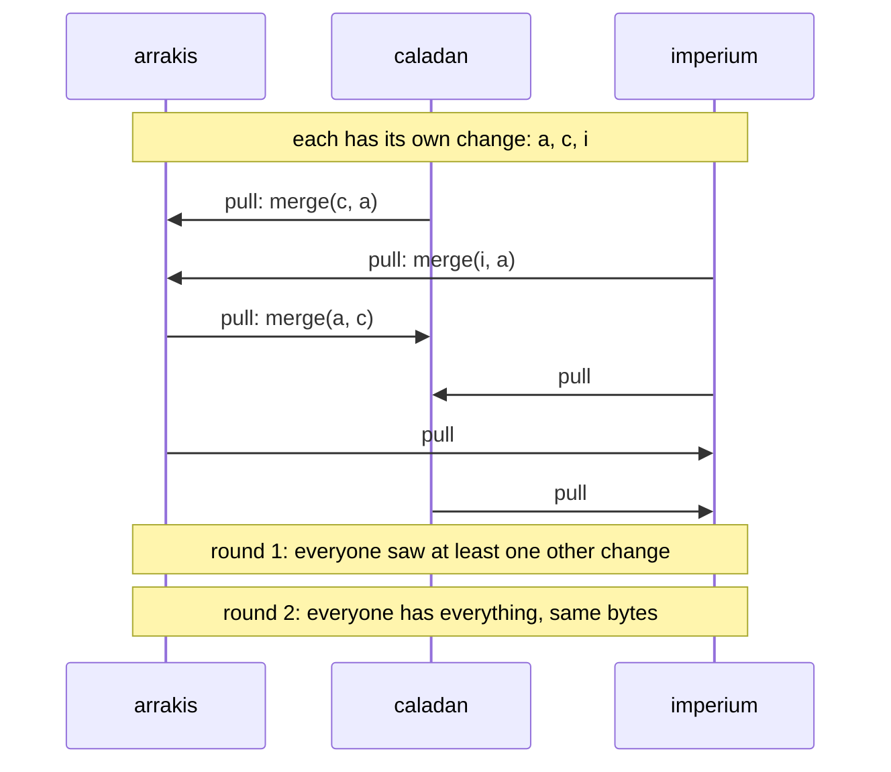

Three properties make this work: every merge is **symmetric** (order of pulls doesn't matter), **idempotent** (merging a result with either input gives it back, so it stops changing) and **lossless** (a merged file contains everything both inputs had, except the conflict loser, which is kept as a copy). After two rounds every change has reached every Mac, and all three hold the same content.

---

## 7. Commands and the loop (`main`)

[`src/main.rs`](../src/main.rs) is thin:

| Command | What it does |
|---|---|
| `serve [--interval SECS]` | server thread on `127.0.0.1:7480`, register with airshell-proxy, then a round every 30 s forever |
| `once` | one round, then exit |
| `status` | this Mac, its config folder, file count, and each peer's `health` |
| `register` | only the proxy registration |

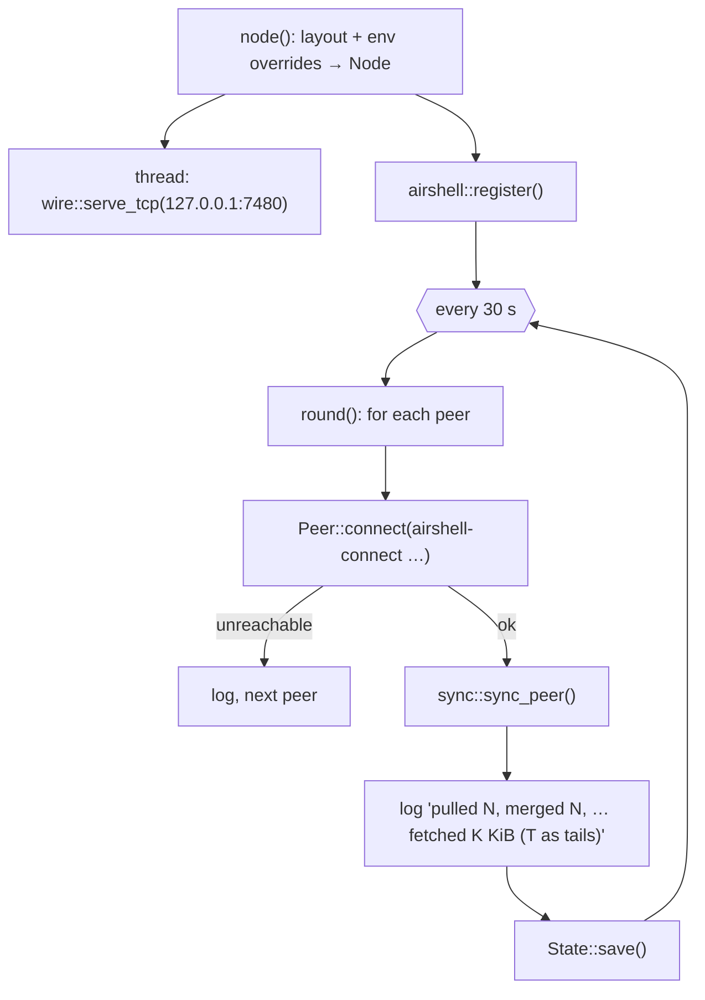

Every `CLAUDE_MESH_*` variable exists so tests (and debugging) can run three Macs in one machine: `CLAUDE_MESH_HOST` picks the identity, `CLAUDE_MESH_CONFIG_DIR` the folder, `CLAUDE_MESH_PEERS` replaces airshell routes with `tcp:` ones, `CLAUDE_MESH_ACTIVE_MS=0` turns off the 60 s window.

Every round, against every peer, is also appended to the **round journal** (`src/journal.rs`, `state.rounds.jsonl` next to the state file): when it started, how long it took, any error, and each file with its action (`pulled`, `merged`, `conflict`, `busy`, `failed`), its bytes and whether it came as a tail. `claude-mesh report` summarizes it, and `claude-mesh status` adds what each peer still has to give (`sync::pending`, the first three decision steps without fetching).

The log line is the main observability. Each round that changed anything says how much it fetched and how much came as tails:

```
[1791748110] arrakis: pulled 1, merged 1, conflicts 0, busy 0, failed 0, fetched 516 KiB (1 as tails)
```

---

## 8. Tests

`cargo test` runs two kinds:

- **Unit tests**, inside each module: the canonical round trip, path safety, merge symmetry, conflict names, live-session matching.
- **End-to-end tests** ([`tests/mesh.rs`](../tests/mesh.rs)): three real `claude-mesh` processes, one per Mac layout, each with its own temporary config folder, talking over localhost (`tcp:` routes; one test uses `nc` as a stand-in for `airshell-connect`).

| Test | Guards against |
|---|---|
| `a_session_moves_between_layouts_with_paths_rewritten` | the canonical form, end to end |
| `a_continued_session_grows_everywhere` | appends reaching every Mac |
| `memory_index_entries_from_every_mac_survive` | memory written on three Macs |
| `credentials_and_settings_never_leave_a_mac` | the `INCLUDE` list |
| `a_command_route_carries_the_stream` | routes that are commands (airshell-connect) |
| `a_file_that_cant_be_written_doesnt_stop_the_round` | ENAMETOOLONG ending a round |
| `two_canonical_forms_of_one_file_dont_conflict_forever` | the conflict-copy cascade |
| `a_grown_log_is_fetched_as_its_tail` | tails |
| `a_diverged_log_falls_back_to_the_whole_file` | tails that don't fit |
| `a_diverged_log_that_keeps_growing_still_comes_as_tails` | the peer's kept copy |
| `a_log_that_reads_back_differently_still_grows_by_tails` | non-reversible paths and tails |
| `an_open_sessions_transcript_is_left_alone_however_quiet` | rewriting a live session |

Each of the last six was written after a real incident and checked to **fail without its fix**.

Lints: `cargo clippy --all-targets -- -D warnings`. The crate turns on `clippy::missing_docs_in_private_items`, so an undocumented item is a warning, and `RUSTDOCFLAGS="-D warnings" cargo doc --document-private-items` catches broken doc links.

---

## 9. Around the code: build, cache, deploy, health

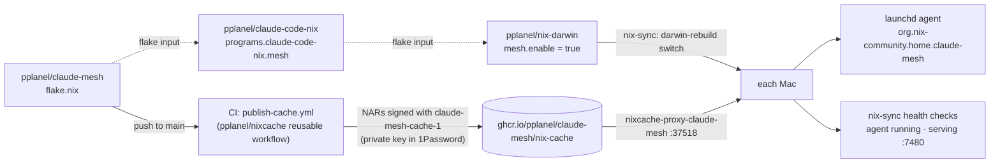

- **`flake.nix`** (this repo): `packages.aarch64-darwin.claude-mesh` with nixpkgs' `rustPlatform`, tests included. It follows no one's nixpkgs on purpose, so consumers build exactly what CI cached.
- **CI** publishes the binary to a GHCR-backed Nix cache on every push to `main`, signed with `claude-mesh-cache-1` (public key in `public-key.txt`, private key in 1Password).
- **claude-code-nix** `programs.claude-code-nix.mesh`: the launchd agent, with `CLAUDE_MESH_LAYOUT` pointing at a JSON made from `handoff.hosts`. `executable` lets a system point the agent at a signed copy at a stable path, so macOS asks for network access once instead of after every upgrade.
- **nix-darwin** turns it on next to the handoff, runs `nixcache-proxy-claude-mesh` on port 37518 so the Macs download the binary instead of building it, and adds two warn-only health checks. Its own `launchd-health.nix` doesn't see home-manager agents, hence these checks: the agent loaded and running (bootstrap or kickstart if not), and something serving on `127.0.0.1:7480`.
- **airshell pairing** is the one manual step: each Mac's `airshell-connect --print-fingerprint` in the others' `~/.config/airshell/authorized_peers`, plus accepting macOS's network prompt on each Mac the first time.

---

## 10. What's fragile

Honest list, worst first.

1. **Deletions don't propagate.** Delete a file on one Mac and it comes back from a peer. To really delete, stop the agent everywhere, delete everywhere, start again. The fix is tombstones: a record that "this path was deleted at T", merged like everything else.
2. **Path rewriting is textual** (section 2). It's handled so it can't loop or conflict forever, but a transcript that quotes another Mac's paths can have the quote rewritten. A structural rewrite of known JSON fields (`cwd`, file paths in tool calls) would be exact but tied to Claude Code's format.
3. **Two branches of a live session stay diverged** until it closes on the Mac that has it open. That's by design (never rewrite a live session), but `claude --resume` on the other Mac shows the merged tree, not the live one.
4. **No compression.** Tails took care of most traffic; whole-file fetches (first sync, new files) still go uncompressed. Transcripts gzip about 4x.
5. **`live_sessions` trusts pids.** A reused pid could keep a dead session "open" a little longer. It only delays a merge; it never loses anything.
6. **The server is unauthenticated on localhost.** Any process on the Mac can read the synced files through `127.0.0.1:7480`. They're your own files, already readable by those processes, but it's worth knowing.
7. **Everyone airshell admits can read everything.** Pairing is all-or-nothing today. When the Macs join an airshell mesh, a service with no `allow` rule admits only the devices of its own member, which fits; just never pair a Mac you don't own.

Next steps that would retire the most risk: tombstones (1), then per-file compression (4), then linking `airshell-net` directly instead of spawning `airshell-connect`, once airshell's mesh membership lands.
